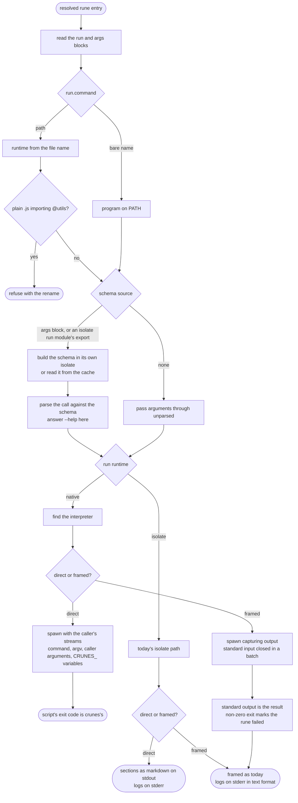

# `crunes run`

The sequence of a `crunes run` invocation across both isolate runes and script runes. Flag parsing, batch splitting and key resolution precede this path; how output reaches the caller is described in [Invocation output](/specs/invocation-output.md).

## 1. The entry is read, not searched

The resolved entry must have a `run` block. Nothing is looked up by convention: an entry without one is a configuration error raised at load, before this flow starts.

## 2. The runtime is known before anything runs

`run.command` is classified once. A bare name is a program on `PATH`. A path is a file, and its name selects the runtime. A plain `.js` or `.mjs` file that imports `@utils` stops here, with the rename that fixes it — the one point in the flow where the file's content is read to decide anything, and it only refuses.

## 3. The schema is settled before the handler is touched

The schema comes from the `args` block if there is one, or from the `args` export of an isolate `run` module if there is not. Either way it is built in an isolate of its own under the grants the configuration spec assigns, and cached unless the module opts out.

With a schema, the call is parsed against it here and `--help` is answered by crunes; no script is spawned for it. Parsing enforces nothing — see the [script rune contract](/specs/script-rune-contract.md). Without a schema, arguments pass through unparsed, `--help` included.

## 4. The path splits twice

**By runtime.** An isolate `run` module continues down today's path: a fresh isolate, the utils bridge, `run`, then `dispose`. A native handler has its interpreter found — or none needed for a program — and is started from the project root with `command`, then `argv`, then the caller's arguments, and the environment the contract lists.

**By invocation.** A single rune in text format is direct; a batch, `--format jsonl`, a child started by `rune.exec` or a job, and `crunes bench` are framed. Crunes decides this from the invocation; the rune has no say. See [Single invocations are direct](/decisions/direct-single-invocation.md).

## 5. Direct: nothing in between

A direct script is spawned with the caller's standard input, output and error, and crunes reads none of them. When it exits, its code is crunes's. A direct isolate rune prints its sections as markdown on standard output as it emits or returns them, and its `console` output goes to standard error.

## 6. Framed: captured and labelled

A framed script is captured: its standard output becomes its result, handled as a string returned from an isolate `run`, and a non-zero exit marks it failed. From there it reaches the same framed renderer as an isolate rune, which is why JSONL, `rune.exec`, batches and section filters need no knowledge of which runtime produced the result.
